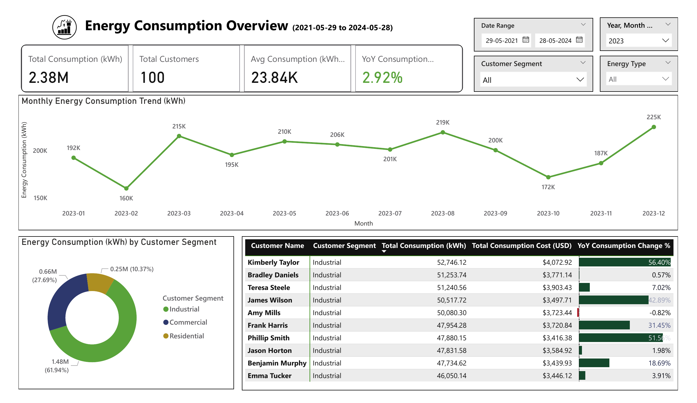
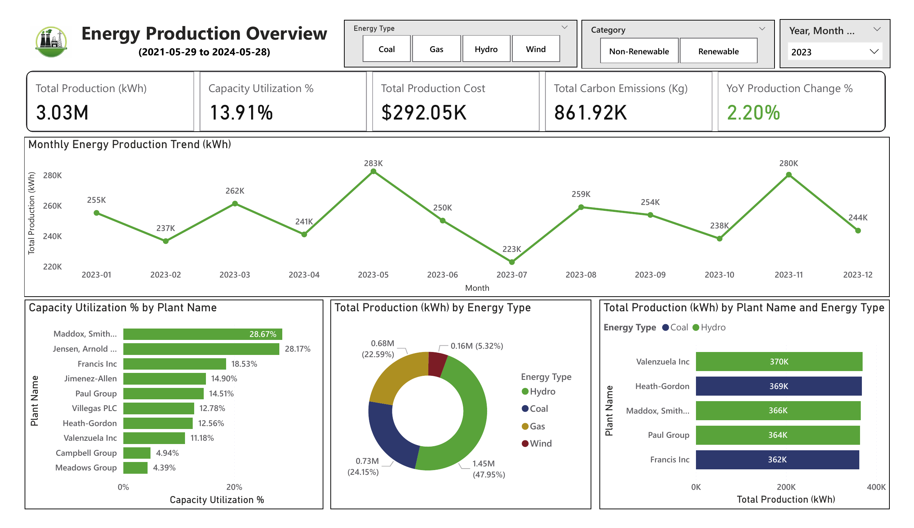
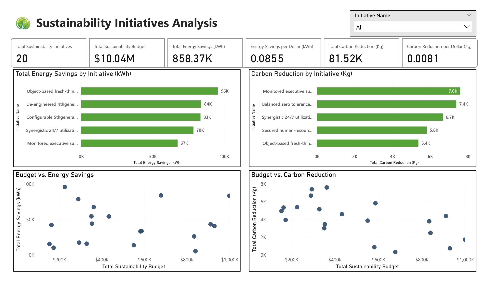

# Energy Consumption & Production Analytics

### SQL | MySQL | Power BI | Data Analysis | Performance Optimization

## Project Overview

This project focuses on analyzing energy consumption, energy production, customer behavior, production plant efficiency, carbon emissions, and sustainability initiatives using **MySQL and Microsoft Power BI**.

The objective is to transform structured energy-related data into meaningful business intelligence through advanced SQL queries, analytical techniques, KPI development, and interactive dashboards.

The project explores key operational and business questions, including customer consumption patterns, production efficiency, energy costs, carbon emissions, and sustainability performance.

It also includes a SQL performance optimization exercise involving table partitioning and indexing to evaluate their impact on query execution time.

**Note:** This project uses a synthetic dataset created for learning and portfolio demonstration purposes. The analysis demonstrates practical data analytics techniques and should not be interpreted as actual energy industry performance.

---

## Business Objectives

The project aims to address the following business objectives:

* **Customer Analytics:** Understand energy consumption patterns across customer segments and identify significant changes in monthly consumption.
* **Production Analytics:** Evaluate energy production performance across plants and energy types.
* **Operational Efficiency:** Assess production capacity utilization and identify differences in production costs.
* **Environmental Performance:** Analyze carbon emissions and compare the environmental impact of energy production.
* **Sustainability Monitoring:** Evaluate sustainability initiatives based on energy savings, carbon reduction, budgets, and duration.
* **Database Optimization:** Explore how table partitioning and indexing can influence SQL query performance.

---

## Tools & Technologies

| Tool / Technology  | Application                                                                 |
| ------------------ | --------------------------------------------------------------------------- |
| MySQL              | Database management and SQL-based analysis                                  |
| SQL                | Data extraction, transformation, aggregation, and analytical querying       |
| Advanced SQL       | CTEs, subqueries, joins, window functions, ranking, and time-based analysis |
| Table Partitioning | Organizing production data using LIST COLUMNS partitioning                  |
| Indexing           | Creating a composite index on energy type and date                          |
| EXPLAIN ANALYZE    | Evaluating SQL query execution performance                                  |
| Microsoft Power BI | Interactive dashboards and business intelligence reporting                  |
| DAX                | KPI development and analytical calculations                                 |
| Power Query        | Data preparation and transformation                                         |

---

## Dataset Overview

The database consists of five relational tables:

| Table                      | Description                                                                                     |
| -------------------------- | ----------------------------------------------------------------------------------------------- |
| Customers                  | Contains customer information, geographical details, customer segments, and registration dates. |
| Energy_Consumption         | Stores customer-level energy consumption records, energy types, and associated costs.           |
| Energy_Production          | Contains production records, energy types, production volumes, costs, and carbon emissions.     |
| Production_Plants          | Stores production plant details, locations, production capacities, and primary energy types.    |
| Sustainability_Initiatives | Tracks sustainability initiatives, allocated budgets, energy savings, and carbon reductions.    |

### Database Relationships

The database contains two defined relationships:

* `Customers[customer_id]` → `Energy_Consumption[customer_id]`
* `Production_Plants[plant_id]` → `Energy_Production[production_plant_id]`

The Sustainability_Initiatives table is analyzed independently because no direct relationship with the other tables is defined in the provided schema.

For detailed column definitions, data types, relationships, and measurement units, refer to the [Data Dictionary](Documentation/Data_Dictionary.md).

---

## SQL Analysis – 15 Business Questions

The project addresses 15 core analytical questions using SQL, covering customer consumption, production performance, environmental impact, sustainability, and operational efficiency.

### 1. Energy Production & Environmental Analysis

1. Identify the top five production plants with the highest average carbon emissions per unit of energy produced.
2. Calculate total energy production for each energy type using window functions.
3. Rank energy production records based on production volume within each energy type.
4. Calculate cumulative energy consumption for each customer over time.
5. Identify the top three highest energy production records within each energy type.
6. Rank production plants based on their average monthly energy production.

### 2. Sustainability Performance

7. Rank sustainability initiatives based on their total energy savings.
8. Analyze monthly energy production for each plant alongside previous and next month's production.
9. Identify each customer's first and last daily energy consumption values in 2023.

### 3. Customer & Operational Analysis

10. Calculate each customer's total energy consumption and average monthly consumption.
11. Calculate average and total carbon emissions for each production plant.
12. Analyze total and average daily energy savings across sustainability initiatives.
13. Evaluate customer segments based on total energy consumption, energy expenditure, average consumption per customer, and average cost per kWh.
14. Evaluate production plants based on capacity utilization and production cost per kWh.
15. Identify customers and customer segments with the largest monthly consumption increases and decreases.

### Advanced SQL Concepts Applied

* Common Table Expressions (CTEs)
* Subqueries
* INNER JOIN
* GROUP BY and HAVING
* Aggregate functions
* Window functions
* ROW_NUMBER(), RANK(), and DENSE_RANK()
* LAG() and LEAD()
* FIRST_VALUE() and LAST_VALUE()
* Running totals and cumulative calculations
* Month-over-month analysis
* Conditional aggregation
* NULLIF() for division-by-zero handling
* Date functions and time-based calculations

---

## SQL Performance Optimization

An additional performance optimization exercise was conducted on the `Energy_Production` table to evaluate the impact of table partitioning and indexing on query execution time.

### 1. Table Partitioning

The `Energy_Production` table was partitioned using **LIST COLUMNS partitioning** based on `energy_type`.

The following four partitions were created:

| Partition | Energy Type |
| --------- | ----------- |
| p_coal    | coal        |
| p_gas     | gas         |
| p_hydro   | hydro       |
| p_wind    | wind        |

This approach organizes production records into separate partitions based on their energy type, allowing the database engine to eliminate irrelevant partitions when applicable.

**Performance Comparison**

The first experiment evaluated a monthly energy production and carbon emissions query filtered by hydro energy.

| Metric                  | Execution Time |
| ----------------------- | -------------: |
| Before Partitioning     |          77 ms |
| After Partitioning      |          50 ms |
| Time Reduction          |          27 ms |
| Performance Improvement |     **35.06%** |

The observed execution time decreased by approximately 35.06% after implementing table partitioning.

### 2. Table Partitioning + Indexing

The second experiment evaluated a monthly carbon emissions query filtered by energy type and date range.

A composite index was created on:

`(energy_type, date)`

The experiment compared query execution using the original table against the partitioned table with the composite index created.

**Performance Comparison**

| Metric                  | Execution Time |
| ----------------------- | -------------: |
| Before Optimization     |          58 ms |
| After Optimization      |          21 ms |
| Time Reduction          |          37 ms |
| Performance Improvement |     **63.79%** |

The observed execution time decreased by approximately 63.79%.

**Important Technical Observation:**

The EXPLAIN ANALYZE output indicated that the query optimizer did not utilize the composite index for this particular query. Instead, it performed a scan within the relevant partition.

Therefore, the observed improvement is attributed primarily to partition elimination rather than demonstrated index utilization.

### Performance Analysis Summary

| Experiment                            | Before | After | Improvement |
| ------------------------------------- | -----: | ----: | ----------: |
| Table Partitioning                    |  77 ms | 50 ms |      35.06% |
| Partitioning + Indexing Configuration |  58 ms | 21 ms |      63.79% |

**Note:** These are observed median execution times from repeated runs in a test environment. The two experiments use different analytical queries, so their improvements should not be treated as a direct comparison of the individual optimization techniques. Actual performance may vary depending on data volume, query structure, execution plans, caching, hardware, and database configuration.

---

## Power BI Dashboard

An interactive Power BI report was developed to present the analytical findings through three dedicated dashboard pages.

### Dashboard Previews

#### 1. Customer Consumption Overview




#### 2. Energy Production Overview



#### 3. Sustainability Performance



### 1. Customer Consumption Analysis

Focuses on customer consumption behavior and expenditure patterns.

Key analytical areas:

* Total energy consumption.
* Customer-level consumption analysis.
* Consumption trends over time.
* Customer segment comparisons.
* Average consumption and expenditure per customer.
* Monthly consumption changes and customer rankings.

### 2. Energy Production Analysis

Focuses on production performance, operational efficiency, and environmental impact.

Key analytical areas:

* Total energy production by energy type.
* Production performance by plant.
* Carbon emissions analysis.
* Production cost per kWh.
* Capacity utilization.
* Plant-level performance comparisons.

### 3. Sustainability Performance

Focuses on monitoring the organization's sustainability initiatives.

Key analytical areas:

* Total energy savings.
* Carbon emissions reduction.
* Initiative budgets.
* Initiative duration and timelines.
* Comparative initiative performance.

---

## Business Insights & Decision Support

The Power BI dashboards provide an analytical overview of customer consumption, energy production, operational performance, and sustainability initiatives.

The following insights are derived from the results displayed in the dashboards and demonstrate how data analytics can support business monitoring and decision-making.

### 1. Customer Consumption Analysis

**Overall Performance**

| KPI                              | Observed Value |
| -------------------------------- | -------------: |
| Total Customers                  |            100 |
| Total Energy Consumption         |      7.20M kWh |
| Average Consumption per Customer |     72.02K kWh |
| Total Consumption Cost           |       $670.83K |

**Customer Segment Analysis**

| Customer Segment | Energy Consumption | Contribution |
| ---------------- | -----------------: | -----------: |
| Industrial       |          4.52M kWh |       62.79% |
| Commercial       |          1.94M kWh |       27.00% |
| Residential      |          0.74M kWh |       10.21% |

**Key Business Insights**

* **Industrial customers dominate energy demand:** Industrial customers account for approximately 62.79% of total energy consumption, making this segment the largest contributor to overall demand.
* **Commercial consumption represents the second-largest segment:** Commercial customers contribute approximately 27% of total consumption, while residential customers account for 10.21%.
* **Customer-level variations:** The customer analysis highlights differences in total consumption and expenditure, helping identify customers with comparatively high energy demand and changes in their consumption patterns.

**Potential Business Recommendations**

* Develop targeted energy management strategies for industrial customers, given their significant contribution to total demand.
* Monitor customers experiencing substantial increases in consumption to understand the underlying drivers.
* Use customer-level consumption and expenditure trends to support segmentation, demand forecasting, and customer engagement strategies.

---

### 2. Energy Production & Operational Performance

**Overall Production Performance**

| KPI                     | Observed Value |
| ----------------------- | -------------: |
| Total Production Plants |             10 |
| Total Energy Production |      8.90M kWh |
| Capacity Utilization    |         13.79% |
| Total Production Cost   |       $860.43K |
| Total Carbon Emissions  |       2.54M kg |

**Energy Production by Type**

| Energy Type | Production | Contribution |
| ----------- | ---------: | -----------: |
| Hydro       |  4.21M kWh |       47.23% |
| Coal        |  2.11M kWh |       23.70% |
| Gas         |  2.09M kWh |       23.51% |
| Wind        |  0.49M kWh |        5.55% |

**Key Business Insights**

* **Hydro is the leading energy source:** Hydro contributes approximately 47.23% of total production, making it the largest energy source in the dataset.
* **Coal and gas have comparable production contributions:** Coal accounts for approximately 23.70% of production, while gas contributes 23.51%.
* **Wind has the smallest production contribution:** Wind represents approximately 5.55% of total energy production.
* **Month-over-month production variations:** The highest month-over-month production change was recorded in March 2024 (+31.45%), while the lowest was recorded in April 2024 (-23.60%), indicating notable variations in energy generation.
* **Production and environmental monitoring:** Total production of 8.90M kWh is associated with 2.54M kg of recorded carbon emissions, highlighting the importance of evaluating production volumes alongside environmental impact.
* **Plant-level production comparison:** The dashboard compares production across individual plants and energy types, allowing differences in production output and capacity utilization to be examined.

**Potential Business Recommendations**

* Monitor the production mix across energy types to understand the organization's dependence on different generation sources.
* Evaluate production costs and carbon emissions alongside production volumes when comparing energy sources.
* Investigate differences in plant-level production performance to identify opportunities for operational improvements.
* Monitor capacity utilization to support production planning and resource allocation.

---

### 3. Sustainability Performance Analysis

**Overall Sustainability Performance**

| KPI                              | Observed Value |
| -------------------------------- | -------------: |
| Total Sustainability Initiatives |             20 |
| Total Sustainability Budget      |        $10.04M |
| Total Energy Savings             |    858.37K kWh |
| Energy Savings per Dollar        | 0.0855 kWh/USD |
| Total Carbon Reduction           |      81.52K kg |
| Carbon Reduction per Dollar      |  0.0081 kg/USD |

**Top Sustainability Initiatives by Energy Savings**

| Sustainability Initiative     | Energy Savings |
| ----------------------------- | -------------: |
| Object-based fresh-thin...    |        96K kWh |
| De-engineered 4thgene...      |        84K kWh |
| Configurable 5thgenera...     |        83K kWh |
| Synergistic 24/7 utilizati... |        78K kWh |
| Monitored executive su...     |        67K kWh |

**Top Sustainability Initiatives by Carbon Reduction**

| Sustainability Initiative     | Carbon Reduction |
| ----------------------------- | ---------------: |
| Monitored executive su...     |          7.6K kg |
| Balanced zero tolerance...    |          7.4K kg |
| Synergistic 24/7 utilizati... |          6.7K kg |
| Secured human-resourc...      |          5.8K kg |
| Object-based fresh-thin...    |          5.4K kg |

**Key Business Insights**

* **Energy savings across sustainability initiatives:** The 20 initiatives collectively report 858.37K kWh in energy savings.
* **Variation in initiative performance:** The highest-performing initiative in terms of reported energy savings contributes approximately 96K kWh.
* **Carbon reduction performance:** The initiatives collectively report 81.52K kg in carbon reductions, with the leading initiative contributing approximately 7.6K kg.
* **Budget and outcome comparison:** The dashboard compares initiative budgets against energy savings and carbon reductions, allowing stakeholders to examine how reported environmental outcomes vary across different investment levels.
* **Different initiatives lead across different metrics:** The initiative with the highest energy savings is not necessarily the one with the highest carbon reduction. This highlights the importance of evaluating sustainability initiatives using multiple performance indicators.

**Potential Business Recommendations**

* Compare sustainability initiatives using both energy savings and carbon reduction rather than relying on a single KPI.
* Investigate initiatives with relatively high environmental outcomes in relation to their allocated budgets.
* Use budget-versus-outcome analysis to support future sustainability investment evaluation.
* Monitor initiative performance over time to assess the consistency of reported savings and reductions.

---

### 4. Cross-Functional Business Perspective

The combined analysis of customer consumption, energy production, and sustainability performance provides a broader view of the organization's operations.

| Business Area          | Analytical Finding                                                 | Potential Business Application                           |
| ---------------------- | ------------------------------------------------------------------ | -------------------------------------------------------- |
| Customer Demand        | Industrial customers contribute 62.79% of total consumption.       | Customer segmentation and demand management.             |
| Energy Production      | Hydro accounts for 47.23% of total production.                     | Production mix monitoring and energy portfolio analysis. |
| Production Variability | Production change ranged from +31.45% to -23.60% month over month. | Production planning and capacity monitoring.             |
| Environmental Impact   | Total recorded carbon emissions are 2.54M kg.                      | Environmental performance monitoring.                    |
| Sustainability         | 20 initiatives report 858.37K kWh in energy savings.               | Sustainability performance evaluation.                   |
| Investment Monitoring  | Total sustainability budget is $10.04M.                            | Budget and environmental outcome comparisons.            |

**Overall Business Perspective**

The analysis demonstrates how customer demand, energy generation, operational costs, carbon emissions, and sustainability outcomes can be monitored through an integrated business intelligence approach.

By combining SQL-based analysis with interactive Power BI reporting, the project illustrates how structured data can be transformed into measurable performance indicators and actionable business questions.

**Data Disclaimer:** All numerical findings are based on the synthetic dataset used in this project. They demonstrate analytical capabilities and potential business applications rather than actual company performance or verified industry trends.

---

## Repository Structure

```text
Energy-Consumption-Production-Analytics/
│
├── README.md
│
├── SQL/
│   ├── energy_analytics_queries.sql
│   └── performance_optimization.sql
│
├── PowerBI/
|   ├── Energy_Analytics_Dashboard.pbix
│   └── Energy_Analytics_Report.pdf
│
├── Dashboard_Screenshots/
│   ├── Customer_Consumption.png
│   ├── Energy_Production.png
│   ├── Sustainability_Performance.png
│   └── Data_Model.png
│
├── Documentation/
│   ├── Business_Questions.md
│   ├── Data_Dictionary.md
│   └── Methodology_and_Assumptions.md
│
└── License
```

---

## How to Explore the Project

### Step 1: Database Setup

* Install MySQL.
* Create a database named `energy`.
* Import the five dataset tables into the database.

### Step 2: SQL Analysis

* Open `energy_analytics_queries.sql`.
* Execute the queries to explore the 15 analytical questions.
* Review the query outputs and analytical results.

### Step 3: Performance Optimization

* Open `performance_optimization.sql`.
* Execute the table partitioning and indexing experiments.
* Use EXPLAIN ANALYZE to inspect query execution.
* Compare the observed execution times.

### Step 4: Power BI Dashboard

* Open `Energy_Analytics_Dashboard.pbix` using Microsoft Power BI Desktop.
* Configure the data source if necessary.
* Refresh the data to explore the interactive report.

### Step 5: Documentation

Refer to the Documentation folder for:

* Business questions addressed by the project.
* Database schema and column-level definitions.
* Analytical methodology and calculation assumptions.

---

## Project Limitations

* The dataset is synthetic and does not represent actual energy company transactions.
* The observed trends and findings are specific to the dataset used.
* The dataset may not capture real-world seasonal variations, operating constraints, or energy market conditions.
* Sustainability initiatives are not directly linked to individual production plants or customers.
* Production capacity utilization depends on the assumed capacity time basis and applicable operating days.
* SQL performance measurements are environment-specific and may vary under different database configurations.

---

## Skills Demonstrated

| Category                | Skills                                                                      |
| ----------------------- | --------------------------------------------------------------------------- |
| SQL & Database Analysis | Joins, CTEs, subqueries, aggregations, window functions                     |
| Advanced SQL            | Ranking, time-series analysis, cumulative calculations, LAG and LEAD        |
| Database Optimization   | Table partitioning, composite indexing, EXPLAIN ANALYZE                     |
| Data Analytics          | Customer segmentation, trend analysis, operational efficiency, KPI analysis |
| Power BI                | Data modeling, interactive dashboards, report development                   |
| DAX                     | Calculated measures and KPI development                                     |
| Business Intelligence   | Performance monitoring, cost analysis, sustainability reporting             |
| Analytical Thinking     | Translating business questions into structured SQL analysis                 |

---

## Author

**Anurag Kashyap**

Data Analyst | Business Intelligence Analyst | Risk Analyst
SQL | Power BI | Python | Statistics | Excel | Gen AI

* LinkedIn: www.linkedin.com/in/anurag-kashyap-49116020
* GitHub: https://github.com/anurag-coder90

Feel free to explore the project, review the SQL queries, and examine the Power BI dashboard.
